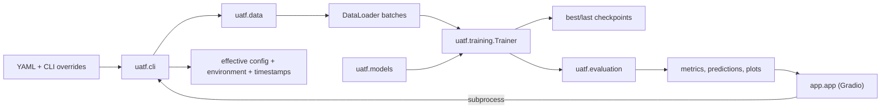

# UATF Architecture

UATF 1.0.0 is a local, single-process image classification framework. The CLI coordinates modules that exchange ordinary PyTorch datasets, batches, models, and tensors. The Gradio UI writes a config and launches that same CLI in a subprocess.

## Training Flow

## Module Responsibilities

| Module | Responsibility | Current contract |
| --- | --- | --- |
| `uatf.data` | Validate folders/CSVs, open and transform images, create splits and loaders | Samples are `(image_tensor, target_tensor)` |
| `uatf.models` | Construct an architecture and replace its classifier head | Model returns raw `[batch, classes]` logits |
| `uatf.training` | Train, validate, compute configured metrics, save/load checkpoints, resume, AMP | Batches contain input and target tensors; loss returns one scalar |
| `uatf.evaluation` | Run inference and calculate classification metrics; write reports, predictions, plots | Task is `classification` or `multi_label` |
| `uatf.config` | Load YAML, merge defaults, validate options and task/data combinations | Returns a normalized configuration mapping |
| `uatf.cli` | Build loaders/model/loss/optimizer, run Trainer and Evaluation, record each experiment | One new output directory per run |
| `uatf.logging_utils` | Configure console and experiment-file handlers | Console is concise; file includes timestamp and severity |
| `app.app` | Accept a ZIP and training choices, run the CLI, display logs/results | Only the two documented classification ZIP layouts |

There is no separate `uatf.tasks` package in this release. Classification task choices are handled through task values and branches in config validation, loss selection, metric selection, evaluation, and UI code. The README and examples should describe the current modules rather than imply a task registry already exists.

## Experiment Outputs

The CLI writes the normalized config before training. The final `metrics.json` includes UATF/Python/PyTorch versions, device, task and model details, dataset path/format/sample counts/class names, training history, evaluation metrics, checkpoint filenames, and UTC timestamps. `train.log` contains the run's INFO messages, DEBUG configuration snapshot, warnings, and exception traceback. Checkpoints and data remain local and are excluded from Git.

The dataset record describes its configured source and summary, not a cryptographic checksum of every image. For strict dataset identity, keep a versioned external dataset manifest alongside the run.

## Adding a Model

Register a builder in `uatf.models.factory.MODEL_REGISTRY`. The builder receives output count and pretrained selection, replaces the architecture's classifier head, and returns an `nn.Module` that emits raw logits. Add tests for output shape and the relevant loss before exposing the model in the UI.

## Adding Object Detection or Segmentation

Detection and segmentation need a task contract before they should be wired into the current classification branches. Expected changes include:

1. Add task configuration/schema for the target format, model head, loss, metrics, and postprocessing options.
2. Extend `uatf.data` with adapters that return structured targets such as boxes and labels or pixel masks. Update transforms so image geometry changes are applied consistently to targets.
3. Define how models return predictions. Detection generally returns per-image dictionaries; segmentation returns class or mask logits. The current `Trainer` requires a single tensor prediction and tensor target, so it needs a small task-aware batch/loss protocol or a separate trainer adapter.
4. Add task-specific losses and evaluation in `uatf.models` and `uatf.evaluation`, including the correct matching, IoU, AP, or mask metrics and prediction export format.
5. Update config validation, CLI setup, Gradio controls, dataset help, README examples, and checkpoint metadata for the new task.
6. Add unit tests for target decoding, geometry transforms, loss shapes, and metrics, plus an end-to-end smoke test on a tiny synthetic dataset.

Model builders can continue to use the existing registry when the backbone is appropriate. The Trainer, dataset adapters, evaluator, and config schema are the main extension points; the current classification metrics and CSV outputs cannot be reused unchanged.
