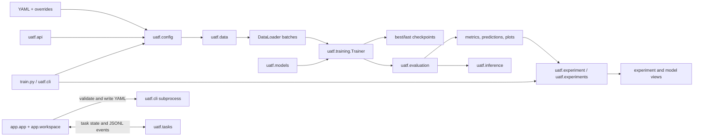

# UATF Architecture

UATF V2.0.0 is a local image-classification framework with shared configuration, training, evaluation, and artifact code for its GUI, CLI, YAML, and Python API workflows. The Gradio interface is a workspace over these modules; it does not implement a separate training algorithm.

## Entry Points and Training Flow

The GUI keeps configuration and monitoring in separate pages. Starting a job writes its configuration and starts the CLI as a child process. The task lifecycle stores job state and structured events so the UI can refresh monitoring while the job continues. Switching workspace pages does not itself stop the child process. Stop requests are cooperative and take effect at a completed epoch boundary.

## Module Responsibilities

| Module | Responsibility | Current contract |
| --- | --- | --- |
| `uatf.config` | Load YAML or Python mappings, merge defaults, apply overrides, validate fields and task/data combinations | Produces a normalized configuration mapping |
| `uatf.data` | Validate folder/CSV datasets, inspect samples, transform images, create deterministic splits and loaders | Samples are `(image_tensor, target_tensor)` |
| `uatf.models` | Build supported architectures, adapt classifier heads, select task-aware losses | Models return raw `[batch, classes]` logits |
| `uatf.training` | Train and validate, compute configured metrics, save/load checkpoints, resume, AMP and training strategies | Batches contain input and target tensors; loss returns one scalar |
| `uatf.evaluation` | Evaluate classification and multi-label assets; write metrics, predictions and plots | Task is `classification` or `multi_label` |
| `uatf.tasks` | Persist task lifecycle, state transitions, stop requests and structured progress events | Task identifiers connect the UI to a CLI run |
| `uatf.experiment` / `uatf.experiments` | Run the shared Python API workflow, index experiment records and model assets, read legacy layouts | Existing run directories remain readable without migration writes |
| `uatf.inference` | Load model assets and predict one image or a directory; export prediction CSV and model sidecars | Uses the same preprocessing and model adapters as training/evaluation |
| `uatf.api` | Provide a higher-level configuration-driven Python interface | Additive facade over shared modules |
| `uatf.cli` / `uatf.cli_wizard` | Execute configuration-driven jobs and provide the interactive CLI workflow | CLI remains usable without Gradio |
| `app.app` / `app.workspace` / `app.monitoring` | Bind Gradio events and compose the workspace; monitor task events, logs, metrics, and resources | GUI delegates business operations to `uatf` modules and the CLI process |

## Persistent Outputs and Compatibility

Each run records its effective configuration, dataset summary, model details, metrics, checkpoints, environment details, timestamps, and logs under the configured output root. Task, experiment, and asset indexes are additional local records. Generated datasets, logs, checkpoints, `outputs/`, virtual environments, build artifacts, and pytest temporary directories are not release source files.

V1 YAML files and historical experiment directories remain readable. Resume requires a compatible full training checkpoint such as `last_model.pth`; inference-only exported weights are not resume checkpoints. See the [migration guide](migration-v1-to-v2.md) for upgrade details.

## Scope and Extension Points

The current training and evaluation contracts support single-label and multi-label image classification on one machine. Detection, segmentation, distributed training, exact content hashing, and managed experiment storage are outside V2.0.0 scope. Adding another task requires coordinated data-target, model-output, loss, trainer, metric, configuration, and UI contracts; the current tensor-classification trainer cannot be reused unchanged for detection or segmentation.

Model builders are registered in `uatf.models.factory.MODEL_REGISTRY`. Dataset adapters, configuration validation, training contracts, and task-specific evaluation are the primary extension points. See [Configuration](configuration.md) for the supported schema and [Phase 9 GUI documentation](phase9-gradio-ui.md) for the workspace structure and behavior.
