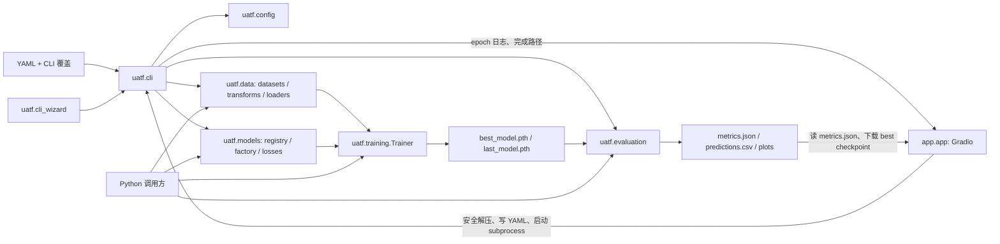

# UATF V2.0.0 Phase 0：代码审查与开发基线

审查日期：2026-10-13  
审查分支：`main`  
审查提交：`d332e4fcfb1fb9a91c9032c87a9eb977e1573242`  
最近发布标签：`v1.0.0`，指向 `378167c31033b7f1047708b9d9ebed030dc8feca`

本文以当前仓库代码和本次执行结果为依据。历史审查 [engineering-review.md](../engineering-review.md) 描述的是 2026-10-08 的旧快照，不应用作当前分支、测试数量或运行环境的证据。

## 结论摘要

- 当前项目已经具备本地单标签和多标签图像分类的端到端训练基础：数据适配、模型注册、训练验证、检查点、评估和结果导出均有实现。
- CLI、双语交互向导和 Gradio UI 都存在。Gradio 通过生成 YAML 并启动同一个 `uatf.cli` 子进程运行训练，没有复制一套训练循环。
- 本次全量测试在指定可写临时目录后为 **50 passed**。CLI 帮助可启动；Gradio 应用构造成功，本机 HTTP 首页返回 200。
- 自动化测试覆盖了单标签 CLI 训练及核心 Trainer、数据、模型和评估路径；多标签 Trainer 的完整训练/恢复/结果产物链路目前没有自动化端到端用例。本次额外做了一次临时 CPU 张量数据 smoke，链路成功，但这不是持久化测试。
- 用户随后在仓库目录验证 `.venv` 和基础解释器均为 Python 3.12.10，成功安装 `.[dev]`，并在修复后的 `.venv` 中运行全量测试，结果为 **50 passed in 17.91s**。Ruff 已运行，但 `ruff check .` 报告 `train.py` 有 1 条可自动修复的 I001。
- 本阶段只审查并新增本文档，不修改训练、配置、CLI、GUI、依赖或发布版本；没有提交、推送或改动 `v1.0.0` 标签。

## 1. 仓库与版本状态

| 项目 | 本次检查结果 |
| --- | --- |
| 分支 | `main`，与 `origin/main` / `github/main` 同步 |
| HEAD | `d332e4f`，提交说明为 `docs: document release and versioning` |
| 工作区 | 初始状态有一个用户已有的未跟踪文件：`docs/UATF-v1.0.0-功能清单.md`。审查过程未修改它 |
| 标签 | 只有 `v1.0.0`；它仍指向发布提交 `378167c` |
| 包版本 | `pyproject.toml` 和 `uatf.__version__` 均为 `1.0.0` |
| 版本记录 | `CHANGELOG.md` 有 `[Unreleased]` 的 CLI 向导和 Windows 启动器记录；版本文档也将该向导列入后续 MINOR 内容 |

未发现 `requirements.txt`、CI 工作流、容器构建或自动发布脚本。运行时及开发依赖主要由 `pyproject.toml` 声明；`dev` extra 声明 pytest 和 Ruff。初次审查时 `.venv` 没有 Ruff；用户随后在仓库目录成功安装 `.[dev]` 并运行 Ruff，发现 `train.py` 有 1 条 I001。仓库有 GPU smoke 脚本、MNIST 示例以及安装、故障排查和 Phase 文档。

## 2. 当前架构与调用关系



| 模块 | 当前职责和边界 |
| --- | --- |
| `uatf.config` | PyYAML safe-load、递归默认值合并、未知字段拒绝、类型/范围/任务与数据格式校验；返回规范化 mapping |
| `uatf.data` | 图片文件夹、单标签 CSV、多标签 CSV 数据集；RGB 解码；预处理；确定性随机拆分和 DataLoader |
| `uatf.models` | torchvision 四种架构的注册表、分类头替换、任务别名和损失选择 |
| `uatf.training` | 接受 `(inputs, targets)` Tensor batch 的通用 Trainer；训练、验证、指标、StepLR、早停、AMP、检查点和 Python resume |
| `uatf.evaluation` | 全量预测、单标签/多标签指标、JSON/CSV 和图表产物；训练后 helper 加载 `best_model.pth` |
| `uatf.cli` | 配置覆盖、数据装配、模型/优化器构建、实验目录、训练、最终评估和运行记录 |
| `uatf.cli_wizard` | 中英文终端交互，收集训练设置、处理支持的数据 ZIP 并生成配置，再回到统一 CLI 流程 |
| `app.app` | Gradio 控件、ZIP 输入、参数检查、配置生成、CLI 子进程、日志解析、结果 JSON 和最佳权重下载 |

目前没有独立 task registry、实验管理器或资源监控包。单标签与多标签分支由 config、loss、metric、evaluation 和 UI 代码共同表达。Trainer 本身没有图像格式依赖，但它要求模型输出 Tensor、目标 Tensor 和标量 loss，不能直接承接目标检测等结构化输出。

## 3. 实际能力检查

### 数据与标签

- 单标签支持按类别子目录读取；也支持带 `image_path,label` 的 CSV。类名按排序建立索引，标签编码为整数。
- 多标签支持 CSV 中一个 `image_path` 列和一个或多个二值标签列；标签顺序来自 CSV 或显式 `label_columns`，目标为 float Tensor。
- 图片路径、重复路径、CSV 列、缺失文件、损坏图像、空数据集和标签值都有校验。图像文件夹会在构造数据集时验证图片可读；CSV 数据集首先检查路径存在，具体解码错误在取样时报告。
- `split_dataset()` 支持确定性 train/validation/可选 test 随机拆分；CLI 当前只创建 train/validation。随机划分不做分层或 group-aware 约束，小样本和相关图像泄漏风险需要使用者处理。
- 训练报告记录样本数量、类名和数据路径，但没有逐图内容哈希或受管数据集清单。现有代码没有单独的 dry-run 检查命令或类别分布统计报告。
- `build_image_transform()` 只做 resize、转 Tensor、按 RGB mean/std 归一化；当前无随机增强流水线。

### 模型、损失与训练

- 模型注册表当前有 `resnet50`、`convnext`、`efficientnet`、`vit`，通过 torchvision 替换输出头并返回 raw logits。
- 单标签使用 `CrossEntropyLoss`；多标签使用 `BCEWithLogitsLoss`。预训练权重通过 torchvision DEFAULT 权重启用，可能需要联网下载；本次没有下载真实权重。
- Trainer 每轮训练后验证，按样本数汇总 loss 和配置指标，记录学习率与耗时。可选 StepLR、early stopping 和 CUDA AMP；AMP 默认关闭并要求 CUDA。
- 每轮写 `last_model.pth`，监控值改善时写 `best_model.pth`。checkpoint 包含模型、优化器、调度器、scaler、epoch/指标、early-stopping 和随机状态；`Trainer.resume()` 可恢复 `last_model.pth` 并返回下一轮编号。
- CLI 当前没有 resume 参数；CLI 和 GUI 也没有停止训练的控制。GUI 展示的进度从 epoch 日志文本正则解析，不是 Trainer 的结构化进度回调。
- 训练状态和错误通过标准 Python logging 输出；CLI 的 epoch 行被 GUI 消费。显存不足、无效 batch、非有限 loss 和 checkpoint 错误都有上下文信息。

### 配置与接口

- 生效配置顺序是内置默认值、YAML、CLI 显式覆盖。当前 CLI 可覆盖 epochs、batch size、learning rate、seed、device、output directory。
- 配置支持 classification/multi_label、数据路径/格式、模型、learning rate 等训练参数、monitor、AMP、StepLR、early stopping、evaluation threshold/primary metric 和输出目录。CLI 固定创建 Adam optimizer，配置目前不能选择优化器类型或参数组。
- `configs/default.yaml` 是参考值而非完整可运行数据集配置。它显式列出 mean/std；`DEFAULT_CONFIG` 将这两个值留给校验阶段填充。两处默认定义可能漂移，但本次看到的 RGB 数值一致。当前配置测试覆盖 example YAML，不覆盖参考默认 YAML 的语义一致性。
- Python 使用方式是各包导出的组件接口（数据集、模型、Trainer、Evaluator、metrics）；没有单一高层 `fit(config)` 公共门面。CLI 的主要路径有模块入口测试，GUI 回调没有自动化测试。

### 评估和输出

- 单标签输出 accuracy、macro/micro precision/recall/F1、per-class 指标和混淆矩阵；不计算单标签 ROC/AUC。
- 多标签输出 threshold 指标、per-label 指标、macro/micro AUC 和 ROC 曲线；只有验证集含正负样本时对应 label 的 AUC 才定义。
- 训练评估保存 `metrics.json`、`predictions.csv` 和 `plots/` 下的 loss/metric 图、混淆矩阵或 ROC 图。CSV 用 DataLoader 顺序下的 `sample_index`，不包含源图片路径。
- `evaluate_model()` 可用于 Python 中的整批/单 batch 评估，`evaluate_training_run()` 会读取实验目录的最佳权重。没有独立评估 CLI，也没有从 checkpoint 直接加载后对任意输入做单张/批量预测的用户工作流。
- 实验按新目录隔离保存 effective config、日志、指标和权重；没有实验历史列表、清理/归档功能或外部追踪数据库。

## 4. 功能现状矩阵

| 能力 | 状态 | 代码或测试证据 / 限制 |
| --- | --- | --- |
| 数据集导入 | 部分实现，需要完善 | CLI 向导和 GUI 都接受 ZIP；底层可直接读取本地目录/CSV。仅支持约定的分类目录和 CSV 结构 |
| 数据集检查与校验 | 已实现且有测试验证 | `uatf.data.datasets` 校验结构、标签、路径、图像和空数据；没有独立 dry-run 命令 |
| 数据集统计 | 部分实现，需要完善 | 训练运行统计总样本数、拆分数量和类名；没有按类/标签分布报告或数据审阅界面 |
| 数据划分 | 部分实现，需要完善 | seeded random split 有单元测试；CLI 只用 train/validation，非分层、非 group-aware |
| 训练参数与配置管理 | 已实现且有测试验证 | default merge、校验、YAML example 和常用 CLI override；UI 仅开放部分参数 |
| 模型注册与构建 | 已实现且有测试验证 | 四个 torchvision 模型、输出头、注册扩展和两种 loss 均有测试 |
| 预训练权重下载 | 暂时无法验证 | 代码连接 torchvision 权重枚举，单测 mock 权重；本次未访问网络或验证本地缓存 |
| 训练循环与验证 | 已实现且有测试验证 | synthetic Trainer integration 和单标签 CLI integration 覆盖 |
| 早停、混合精度、学习率调度 | 已实现且有测试验证 | StepLR/early stopping 集成测试；当前 CUDA 环境下套件通过 AMP 路径 |
| 实时进度与训练指标 | 部分实现，需要完善 | CLI 输出每轮日志；GUI 解析 epoch、loss 和 task metric。无 batch 级回调/队列接口 |
| 资源监控 | 尚未实现 | 没有 CPU/GPU 利用率、显存或资源历史视图/记录 |
| 停止训练与失败处理 | 部分实现，需要完善 | 错误记录并以非零状态返回；支持 Ctrl+C。GUI 没有 stop/cancel，CLI 无恢复开关 |
| Python 断点续训 | 已实现且有测试验证 | Trainer resume 恢复 optimizer/scheduler/RNG 等状态；CLI/GUI 未开放 |
| 实验历史和产物管理 | 尚未实现 | 每次 run 新建目录并保留文件；没有历史索引、浏览、归档和清理管理 |
| 最佳/最近检查点 | 已实现且有测试验证 | best/last 自动保存、读取和恢复有集成测试 |
| 独立评估 | 底层已有、GUI 尚未开放 | Python evaluator 支持模型+loader；CLI 没有独立评估命令，训练后 helper 只评估训练验证集上的 best checkpoint |
| 单张/批量推理 | 部分实现，需要完善 | evaluator 内部支持任意 batch iterable；无用户级 checkpoint 加载/预测命令，CSV 无源路径 |
| 数据增强与预处理 | 部分实现，需要完善 | resize、tensor、normalize 已实现并有数据测试；随机增强没有实现 |
| 混淆矩阵、ROC、预测 CSV | 已实现且有测试验证 | 混淆矩阵图用于单标签；ROC/AUC 用于多标签；两类 CSV/图表产物有测试 |
| 环境诊断、日志、测试、发布 | 部分实现，需要完善 | 有 GPU smoke、logging、pytest 和版本文档；本地 Ruff 已运行但有 1 条 I001；无自诊断总览、CI 或自动发布流水线 |

状态含义：**已实现且有测试验证**指当前代码实现并被本次通过的自动化用例覆盖；**底层已有、GUI 尚未开放**指存在可调用模块但没有相应 GUI 入口；**部分实现**表示只有其中一段工作流可用；**暂时无法验证**表示本次环境/数据条件不能确认。未单独列出的图像检测、分割和非图像任务不属于当前实现范围。

## 5. GUI 控件与后端映射

GUI 位于 `app/app.py`，当前组件均连接到回调或任务配置，不存在仅用于展示的训练按钮占位。实际映射如下：

| 控件 / 显示 | 实际后端行为 | 当前边界 |
| --- | --- | --- |
| 任务下拉框 | 切换单标签/多标签并更新格式说明 | 仅两种分类任务 |
| 数据 ZIP 上传 | `_safe_extract_dataset()` 解压到 UI 上传目录，并检查预期目录/CSV | 不接受普通本地路径或任意数据格式 |
| 模型下拉框 | 取自 `MODEL_REGISTRY`，生成 YAML | GUI 固定 `pretrained: false` |
| Epochs、Batch Size、Learning Rate | 校验数值并写入 YAML | 没有 seed、image size、validation fraction、normalization 或 optimizer 控件 |
| Device | 写入 `training.device` | 可选 auto/cuda/cpu；不负责安装或诊断 CUDA |
| 开始训练 | 启动 `python -m uatf.cli --config ...` 子进程 | 不另行实现 Trainer |
| 状态、epoch、loss、metric、日志 | 逐行解析 CLI stdout；epoch 行到达后 yield UI 更新 | 无 batch 级实时进度、显存/CPU 监控；依赖日志文本格式 |
| Metrics JSON | 读取 CLI `metrics.json` 部分内容并展示 | 不展示/链接 CSV 和图表 |
| 最佳模型下载 | 提供实验目录中的 `best_model.pth` | 不提供 last checkpoint、恢复或直接预测 |
| 未提供的控件 | CLI/YAML 部分底层参数仍可使用 | GUI 没有 AMP、scheduler、early stopping、monitor、实验命名、resume、stop、独立评估/预测和实验浏览 |

## 6. 测试和运行基线

### 自动化测试

测试文件位于 `tests/unit/` 与 `tests/integration/`，覆盖配置解析/校验、folder 和 CSV 数据集、模型与 loss、指标/评估产物、Trainer 验证/早停/AMP/检查点恢复，以及一个单标签 CLI 训练流程。没有 GUI 回调测试，也没有自动化的多标签 Trainer 训练端到端测试。项目没有配置覆盖率报告，不能报告覆盖率百分比。

完整测试命令及结果：

```text
python -m pytest -q -p no:cacheprovider --basetemp=<可写临时目录>
50 passed in 24.28s
```

本次默认 pytest 临时目录落在受限制的用户 Temp 路径，首次执行出现 27 个 `tmp_path` fixture setup 权限错误，另有 23 个用例通过。将 `--basetemp` 指向会话可写目录并禁用 pytest cache plugin 后，全量套件为 50 passed；失败是测试临时目录权限，不是断言失败。没有跳过或删除任何测试。

另用未落盘到仓库的合成张量数据运行了 1 epoch CPU 多标签 Trainer，检查 `Trainer.resume()` 返回下一轮为 2，并执行 `evaluate_training_run()`。best/last checkpoint、`metrics.json`、`predictions.csv` 和 ROC 图均存在。Matplotlib 因用户级缓存目录不可写打印一条 cache lock 提示，但图表生成成功。这是本次手动 smoke，不替代持久化自动化用例。

### CLI、GUI 与环境

| 检查 | 实际结果 |
| --- | --- |
| 标准虚拟环境 | 初次审查时启动器报告基础 Python 3.12.10 不存在。用户随后在仓库目录运行 `venv --upgrade .venv` 后验证基础解释器和 `.venv` 均输出 Python 3.12.10；`.venv/pyvenv.cfg` 的基础路径现已存在 |
| 初次审查运行时 | 工作区提供的 Python 3.12.14 加载仓库 `.venv\Lib\site-packages`；PyTorch 2.7.1+cu128、torchvision 0.22.1+cu128、Gradio 6.29.1、pytest 9.1.1。全量 50 个测试通过的结果来自该次运行 |
| 用户复核安装与测试 | 在仓库目录运行 `pip install -e '.[dev]'` 成功；截图显示 Ruff 版本为 0.17.0。随后在修复后的 `.venv` 中运行 `python -m pytest -q -p no:cacheprovider --basetemp $testTmp`，截图结果为 `50 passed in 17.91s` |
| CUDA | `torch.cuda.is_available()` 为 true；检测到 NVIDIA GeForce RTX 5080 Laptop GPU，runtime 12.8。没有下载外部数据或权重 |
| CLI | `python -m uatf.cli --help` 以退出码 0 启动并列出 YAML、交互向导与覆盖参数 |
| GUI | `build_app()` 成功构造 Gradio Blocks（27 个组件）；本机 `127.0.0.1:17860` 启动后 HTTP 首页返回 200，验证完成后已停止服务 |
| 预训练权重 | 未验证真实联网下载或缓存读取；模型单测使用 mock，避免外部网络依赖 |
| Ruff | 用户在仓库目录运行 `ruff check .`；发现 1 条可修复 I001，位置 `train.py:3`。`ruff check train.py --diff` 显示修复仅移除 `if __name__` 前多余的一行空行；没有修改源码 |
| 外部数据质量/精度 | 没有下载数据集或评估模型质量；合成 smoke 只验证代码路径 |

本复核会话能够读取 `.venv/pyvenv.cfg` 和解释器文件，但执行 Python/pytest 时操作系统返回“拒绝访问”；因此本会话无法独立重跑用户截图中的解释器。用户随后提供的 PowerShell 截图确认修复后的 `.venv` 全量测试通过。pytest 仍需显式指定可写 `--basetemp`；不要把用户机器上的绝对运行时路径写进项目脚本。

## 7. 风险与维护注意事项

1. 用户已在修复后的 `.venv` 中复核 50 个测试通过；本复核会话仍受 Python 启动权限和默认 pytest 临时目录写入限制，不能独立重跑该结果。
2. 训练启动/组装、结果目录和报告落盘较多集中在 `uatf.cli`；Gradio 又解析文本日志获取进度。将来增加 GUI 控件或回调时，应让两个入口调用同一应用层能力，避免第二套训练流程。
3. 训练拆分没有 stratification/group awareness，评估报告也不保存每行源图路径或精确数据清单；数据偏斜、重复主体和数据版本变化可能影响可解释性。
4. config 的 Python 默认值和 `configs/default.yaml` 参考值有重复表达，默认 YAML 也不是包含数据路径的完整训练文件。需要明确唯一默认来源和参考文件的定位，并为默认值关系补测试。
5. GUI 对 CLI epoch 文本格式有耦合；更换日志格式可能使进度不刷新。当前 UI 没有训练取消、resume、独立评估/推理、历史管理或资源监控。
6. 当前测试对 multi-label dataset/evaluation 有覆盖，但缺少多标签训练引擎到 checkpoint/resume/产物的自动端到端链路；GUI zip 回调与失败分支也没有自动化检查。
7. 预训练模型会触发 torchvision 网络/缓存行为。本次未在无网络条件下验证下载失败提示和恢复路径。
8. 只支持单标签和多标签图像分类。检测、分割及其结构化目标、损失和指标需要单独任务契约，不应通过扩充当前 logits 分支来假设已经兼容。

## 8. V2.0.0 建议模块边界

先保留现有职责清楚的包，不为 Phase 0 重构。后续按实际共用需求逐步增加薄边界：

| 建议边界 | 放入职责 | 约束 |
| --- | --- | --- |
| `uatf.config` | 配置解析、默认值、schema/字段校验和覆盖优先级 | 定义默认来源；CLI/UI/API 不各自重复校验 |
| `uatf.data` | adapters、输入检查、统计、transform、split、DataLoader | 格式实现可插拔；默认 split 改变前必须有迁移说明和回归测试 |
| `uatf.models` | 模型 registry、head builder、loss/task 输出约定 | 保留 logits 契约；预训练网络行为显式可验证 |
| `uatf.training` | 训练/验证、scheduler、early stop、checkpoint、resume、结构化状态事件 | 不依赖 Gradio；取消语义和保存边界写进接口 |
| `uatf.evaluation` | 加载检查点后的评估、推理、指标和预测格式 | 训练验证、独立评估和预测共享底层评估逻辑 |
| `uatf.experiments`（建议新增） | run 目录、manifest、产物清单、历史查询 | 初期用本地文件，不先引数据库；禁止覆盖已有 run |
| `uatf.application`（建议新增） | 从规范化配置协调 data/model/trainer/evaluator 的应用服务 | CLI、GUI、Python API 共用；训练循环仍只有一份 |
| `uatf.diagnostics`（可选新增） | Python/PyTorch/CUDA/依赖/目录权限检查 | 只报告可观察事实，不自动更改用户环境 |
| `uatf.cli` / `app.app` | 参数解析和用户交互、状态展示 | 不放领域训练实现；GUI 的事件和取消控制走共享服务接口 |

是否新增 `experiments`、`application` 或 `diagnostics` 包，应在对应 Phase 以实际重复和调用需求为依据，不作为预先大规模重构目标。

## 9. Phase 1–8 推荐顺序、前置条件与验收

依赖顺序建议为 **测试/契约 → 数据工作流 → 共用配置/API → 训练生命周期 → 实验记录 → 独立评估/推理 → GUI → 发布硬化**。每一阶段只扩展当期范围，并保留现有分类路径。

| Phase | 建议范围与前置条件 | 验收标准 |
| --- | --- | --- |
| 1. 回归基线与接口契约 | 以本次代码和测试基线为起点；先解决团队可复现的 Python/pytest 入口，再冻结现有配置、batch、checkpoint 与结果约定 | 无网络 CPU 测试覆盖 config、合成单标签/多标签训练、checkpoint/resume、metrics/CSV/plots；CLI 与 Python 调用有基本回归；CUDA 测试可选且明确 skip |
| 2. 数据接入、检查与统计 | 依赖 Phase 1 的测试 fixtures 和已确认的 folder/CSV 标签约定 | 所有现有格式可在训练前检查；报告拆分和类别/标签计数；路径、损坏图、空类、小样本错误有测试；拆分可复现且不重叠；任何默认划分改变有兼容说明 |
| 3. 配置和共用 Python 工作流 | 依赖稳定的 Phase 1 契约与 Phase 2 数据适配接口 | 内置默认、YAML、CLI override 的优先级有测试；公开 Python API 能调用共用训练服务；CLI 和 GUI 仍复用同一实现；配置示例均校验 |
| 4. 训练生命周期 | 依赖 Phase 3 的服务入口和现有 checkpoint 状态 | CLI/API 可恢复 `last` 并检查设置不兼容；结构化进度可供 GUI 消费；停止语义在 epoch 边界明确；失败状态、日志和异常可查；没有第二个 Trainer |
| 5. 实验和产物管理 | 依赖稳定配置、训练事件和 checkpoint metadata | 每个 run 可查找、互不覆盖；manifest 记录有效配置、模型、数据来源/统计、运行环境和产物；历史浏览/归档操作有测试，不删除用户数据 |
| 6. 独立评估与预测 | 依赖 Phase 5 可发现的 checkpoint 和 Phase 2 可复用的数据 adapter | 不训练即可按 checkpoint 执行单标签/多标签评估、单图与批量预测；指标/阈值/CSV 包含可追溯样本标识；失败 checkpoint 和类别映射有清晰错误 |
| 7. GUI 能力对齐 | 依赖 Phase 3 共用 API、Phase 4 状态/停止协议和 Phase 6 评估接口 | 每个控件映射到底层参数并有回调测试；支持可用能力的训练、停止/恢复、评估和产物浏览；进度不是靠解析脆弱的日志格式；不复制训练逻辑 |
| 8. 稳定化与发布准备 | 依赖 Phase 1–7 的验收记录与兼容性说明 | 全量 CPU 回归、可用 CUDA smoke、CLI/GUI 启动、lint 和安装/构建检查均有真实结果；文档/示例/CHANGELOG 一致；发布版本策略确认后再变更版本和新增标签；绝不移动 `v1.0.0` |

## 10. Phase 0 验收状态与下一阶段入口

| Phase 0 验收项 | 结果 |
| --- | --- |
| 检查分支、工作区、标签和版本 | 通过；已有未跟踪用户文件已记录并保留，`v1.0.0` 未改动 |
| 审查核心模块、CLI/API/GUI、配置、产物和现有测试 | 通过；按当前实现记录于本文 |
| 运行现有测试并记录真实结果 | 通过；初次基线 50 passed，用户修复 `.venv` 后再次运行也为 50 passed（17.91s），均显式指定可写 pytest 临时目录 |
| 验证 CLI 和 GUI 启动能力 | 通过；CLI help 退出码 0；GUI 首页 HTTP 200 |
| 验证 CPU 多标签训练/恢复/产物的最小路径 | 手动 smoke 通过；仍缺自动化测试 |
| 验证真实数据下载和预训练权重下载 | 未做；不是当前环境离线基线的一部分 |
| 验证 Ruff 和自动发布流程 | Ruff 已运行，未通过：`train.py` 有 1 条 I001；自动发布流程无实现，无法验证 |

**Phase 1 前置条件基本满足。** 用户已验证仓库 `.venv` 能以 Python 3.12.10 启动、开发依赖安装成功，且修复后的环境全量测试 50 passed。Ruff 仍有 1 条 I001，需在进入发布硬化前处理；Phase 1 仍应优先把多标签训练 smoke 纳入自动化回归，再开始新增数据或 GUI 能力。

